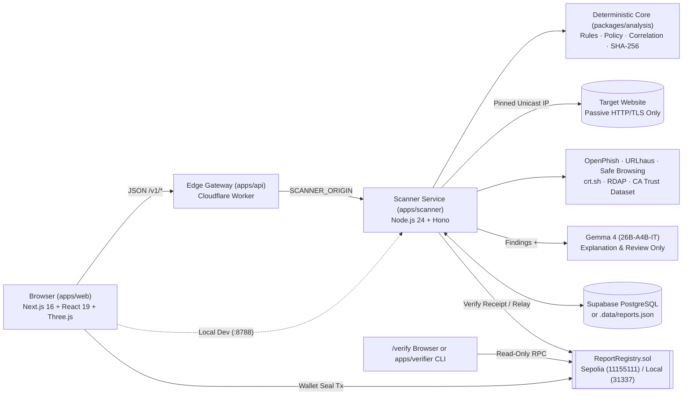

<div align="center">


# Veriq — Verify Before You Trust

**Passive Cybersecurity Investigation, Grounded Gemma 4 AI Explanations, and On-Chain Threat Report Verification**

[](https://veriq.axiomjisu.tech)
[](https://sepolia.etherscan.io)
[](https://veriq.axiomjisu.tech/privacy)
[](https://veriq.axiomjisu.tech/terms)
[](./LICENSE)

<br />


</div>

---

## Team Details — **Axiom**

| # | Name | Role | GitHub Profile |
| :-: | :--- | :--- | :--- |
| 1 | **Ankit Dey** | **Team Leader** | [@ankit-github](https://github.com/nonsense3) |
| 2 | **Sanchari Ganguly** | **Team Member** | [@sanchari-github](https://github.com/SANCHARI-GANGULY) |
| 3 | **Rashmi Pyne** | **Team Member** | [@rashmi-github](https://github.com/rashmi-crypto) |
| 4 | **Souvik Das** | **Team Member** | [@souvik-github](https://github.com/dasouvik122005) |

---

## Table of Contents

- [01. Project Name and One-Line Description](#01-project-name-and-one-line-description)
- [02. Problem](#02-problem)
- [03. Solution](#03-solution)
- [04. Demo Links and Screenshots](#04-demo-links-and-screenshots)
- [05. Quick Start - Setup and Run](#05-quick-start---setup-and-run)
- [06. Tech Stack](#06-tech-stack)
- [07. Architecture](#07-architecture)
- [08. Disclosures](#08-disclosures)

---

## 01. Project Name and One-Line Description

**Veriq** — *An evidence-first cybersecurity investigation platform that inspects suspicious links, domains, and scam messages through passive network/TLS intelligence, explains findings using grounded **Gemma 4** AI, and anchors tamper-evident cryptographic report commitments on the Ethereum blockchain.*

---

## 02. Problem

| Problem Area | Why Current Approaches Fail |
| :--- | :--- |
| **1. The "HTTPS Padlock" Fallacy & CA Failures** | Phishing sites routinely obtain valid DV TLS certificates within minutes. Furthermore, standard OS/browser trust stores often lag behind real-world Certificate Authority compromises—such as the **October 2026 eMudhra incident**, where 8 intermediate CAs were generated with single-byte ECDSA P-384 private keys ($d \in \{4, 56, 66, 115, 155, 156, 230, 237\}$), leaving standard TLS verifiers reporting compromised chains as "trusted." |
| **2. Multi-Vector Social Engineering (SMS / UPI / OTP)** | Fraud often arrives as pasted SMS, WhatsApp, email, or recruitment lures demanding urgent KYC updates, OTPs, or upfront fees via **UPI IDs**, IFSC bank transfers, or crypto wallets. Naive keyword scanners trigger false positives on legitimate urgent reminders that warn *"Never share your OTP."* |
| **3. Black-Box Verdicts & AI Prompt Injection** | Traditional link checkers output a binary "Safe / Unsafe" label without exposing technical evidence, redirect chains, or check coverage. Meanwhile, feeding raw webpages to an ungrounded LLM exposes the scanner to **prompt injection** (hidden text instructing the AI to declare the site safe) and hallucinated evidence. |
| **4. Scanner Weaponization (SSRF & Script Execution)** | Security scanners become attack surfaces themselves if attackers use them to probe internal/cloud metadata networks (`127.0.0.1`, `169.254.169.254`, IPv6-mapped IPv4, DNS rebinding) or execute malicious scripts in a headless browser. |
| **5. Mutable & Unverifiable Threat Reports** | Centralized security reports can be altered or deleted after publication, while putting raw reports on-chain leaks private URLs, victim messages, and personal identifiers. |

---

## 03. Solution

Veriq solves these challenges through a **5-Step Pipeline** (`Submit → Investigate → Analyse → Assess → Verify`) across **6 Analytical Modules**:

| Module | What Veriq Does |
| :--- | :--- |
| **1. Safe Passive Link & Domain Analysis** | Refangs defanged URLs (`hxxp://`, `[.]`), strips `user@` credentials, converts IDNs to punycode, detects typosquatting & Unicode homographs, validates global-unicast DNS (`A`/`AAAA`/`CNAME`/`MX`/`NS`), queries `RDAP` domain age, safely walks up to **8 redirects** with socket IP pinning, and parses HTML inertly (titles, brand claims, cross-origin credential `<form action>` targets) **without executing scripts**. |
| **2. Deep TLS & Certificate Trust Intelligence** | Inspects full X.509 certificate chains, SAN/hostname match, TLS version/cipher, RSA/ECDSA key size, DER signature OIDs, OCSP stapling, and `crt.sh` Certificate Transparency logs. Matches SPKI hashes against `ca-trust-2026.11.07`, catching the 8 compromised **October 2026 eMudhra P-384 intermediate CA keys** and distrusted roots (`DigiNotar`, `WoSign`, `StartCom`, `TrustCor`, `Camerfirma`, `E-Tugra`, `Entrust`, `eMudhra`). |
| **3. Inert Scam Message & Email Analysis** | Parses up to 20,000 characters of pasted text to extract URLs, emails, phone numbers, **UPI IDs**, crypto wallets, IFSC codes, and amounts. Automatically redacts PII for display (`******3210`), hashes indicators with SHA-256 for correlation, and performs sentence-level negation analysis so protective warnings (*"Never share your OTP"*) do not cause false positives. |
| **4. Threat Intelligence & Campaign Correlation** | Queries **OpenPhish** (live, keyless, hourly refresh), **abuse.ch URLhaus**, **Google Safe Browsing v4**, **crt.sh**, **RDAP**, and the **Veriq Threat Repository**. Links related incidents into **Campaign Clusters** across shared domains, certificate fingerprints, UPI/wallet/phone hashes, and 4-word text shingles—never linking on shared hosting IP alone. |
| **5. Deterministic 5-Class Policy + Grounded Gemma 4 AI** | Deterministically classifies reports into `Low Risk`, `Suspicious`, `High Risk`, `Confirmed Malicious`, or `Inconclusive` (`veriq-policy-2026.11.1`), keeping server configuration issues (`missing HSTS/CSP`) separate from phishing risk. **Gemma 4 (`gemma-4-26b-a4b-it`)** explains findings in plain language strictly citing deterministic finding IDs (`F01`, `F02`, ...) and reviews repository publications without ever altering the risk verdict. |
| **6. Web3 Report Registry & Independent Verifier** | Computes a canonical, salted SHA-256 commitment (`veriq-commitment-v1`) over the report and a private 32-byte nonce. Users seal commitments on **Ethereum Sepolia (`11155111`)** via browser wallet (`MetaMask`) or backend relayer. Anyone can verify a downloaded **Verification Bundle** via `/verify` in the browser or the zero-dependency CLI (`apps/verifier/verify.mjs`). |

---

## 04. Demo Links and Screenshots

### Live Deployment, On-Chain Evidence & Legal Links

| Resource | Details / Link |
| :--- | :--- |
| **Live Web Application** | [https://veriq.axiomjisu.tech](https://veriq.axiomjisu.tech) |
| **Investigation Workspace** | [https://veriq.axiomjisu.tech/dashboard](https://veriq.axiomjisu.tech/dashboard) |
| **Public Threat Repository** | [https://veriq.axiomjisu.tech/repository](https://veriq.axiomjisu.tech/repository) |
| **Independent Browser Verifier** | [https://veriq.axiomjisu.tech/verify](https://veriq.axiomjisu.tech/verify) |
| **Privacy Policy** | [](https://veriq.axiomjisu.tech/privacy) |
| **Terms of Service** | [](https://veriq.axiomjisu.tech/terms) |
| **Blockchain Network** | [-627EEA?style=flat-square&logo=ethereum&logoColor=white)](https://sepolia.etherscan.io) & Local Hardhat (`31337`) |
| **Public Verification RPC** | `https://ethereum-sepolia-rpc.publicnode.com` / `http://127.0.0.1:8545` |

---

### Step-by-Step Visual Walkthrough (Screenshots)

| Step | Screen & Description | Screenshot |
| :-: | :--- | :--- |
| **01** | **Home Page & Live Evidence Graph**<br/><br/>Interactive landing page featuring the 3D/WebGL live evidence graph and unified intake composer for investigating a **Link or domain** or a pasted **Message or email**. |  |
| **02** | **Five Steps, One Answer**<br/><br/>End-to-end investigation pipeline: **01 Submit** $\rightarrow$ **02 Investigate** $\rightarrow$ **03 Analyse** $\rightarrow$ **04 Assess** $\rightarrow$ **05 Verify**. |  |
| **03** | **Six Views of One Link**<br/><br/>Unified inspection across **Link & domain**, **Certificate**, **Page identity**, **Messages**, **Intelligence**, and **Correlation**. |  |
| **04** | **Risk Assessment Overview**<br/><br/>Clear 5-class risk verdict with confidence rating, check coverage (`7/8 checks`), WebGL particle shield, and separated dimension badges (**Phishing**, **Certificate**, **Configuration**, **Intelligence**). |  |
| **05** | **Technical Evidence & TLS Certificate Chain**<br/><br/>Deep inspection of redirects, TLS 1.3 handshake, Certificate Transparency (`crt.sh`) status, leaf/intermediate/root certificate hierarchy, recommended actions, and checked threat feeds (`OpenPhish`, `URLhaus`, `Google Safe Browsing`). |  |
| **06** | **Sealing Report On-Chain via Browser Wallet**<br/><br/>Signing the `register()` transaction on **Ethereum Sepolia Testnet** using MetaMask while keeping private keys in the user's wallet and raw evidence off-chain. |  |
| **07** | **Confirmed On-Chain Integrity Receipt**<br/><br/>Verified Sepolia receipt showing Chain ID `11155111`, Transaction Hash, Contract Address, Record Key, Commitment Fingerprint, Block Number, and one-click **Verification Bundle** & **Receipt** downloads. |  |
| **08** | **Transaction Receipt on Sepolia Etherscan**<br/><br/>Public block explorer confirmation of the on-chain `register()` transaction on **Ethereum Sepolia Testnet**. |  |
| **09** | **Independent Browser Verification (`/verify`)**<br/><br/>Recomputing the canonical SHA-256 fingerprint from the downloaded bundle and verifying it directly against the Ethereum Sepolia RPC (`https://ethereum-sepolia-rpc.publicnode.com`). |  |
| **10** | **Public Threat Repository & Community Review**<br/><br/>Sanitized incident feed (`/repository`) displaying redacted indicators, configuration weaknesses, campaign correlation clusters, and sybil-resistant one-vote-per-account Confirm / Dispute discussions. |  |

---

## 05. Quick Start - Setup and Run

### 1. Prerequisites & Installation

Requires **Node.js 22+** (tested on v24.11.0) and **pnpm 11+**.

```bash
git clone https://github.com/nonsense3/Veriq.git
cd Veriq
pnpm install
cp .env.example .env
```

### 2. Run Locally

```bash
# Terminal 1 (Optional if using Sepolia): Start local EVM chain on :8545 (Chain ID 31337)
pnpm chain:node

# Terminal 2 (Once per local chain start): Deploy ReportRegistry.sol to localhost
pnpm chain:deploy

# Terminal 3 (Required): Start the Node investigation scanner on :8788
pnpm dev:scanner

# Terminal 4 (Required): Start the Next.js frontend on http://localhost:3000
pnpm dev
```

### 3. Environment Variables (`.env`)

| Variable | Required? | Purpose |
| :--- | :-: | :--- |
| `AI_PROVIDER` / `AI_MODEL` | Optional | Defaults to `google` and `gemma-4-26b-a4b-it` (or `openai_compatible` for self-hosted Gemma). |
| `GOOGLE_AI_API_KEY` | Optional | Google AI Studio key for **Gemma 4** explanations. Verify with `node apps/scanner/scripts/check-ai.mjs`. |
| `NEXT_PUBLIC_SUPABASE_URL` / `NEXT_PUBLIC_SUPABASE_PUBLISHABLE_KEY` | Optional | Supabase project URL and publishable key for accounts and profile history. |
| `SUPABASE_SECRET_KEY` | Optional | Server-only Supabase key for persistence (falls back to `apps/scanner/.data/reports.json` if omitted). |
| `URLHAUS_AUTH_KEY` / `GOOGLE_SAFE_BROWSING_API_KEY` | Optional | API keys for URLhaus and Google Safe Browsing v4 (`OpenPhish`, `crt.sh`, and `RDAP` work without keys). |
| `REGISTRY_RPC_URL` / `REGISTRY_PUBLIC_RPC_URL` | Yes (for Web3) | Sepolia RPC (`https://ethereum-sepolia-rpc.publicnode.com`) or local Hardhat (`http://127.0.0.1:8545`). |
| `REGISTRY_CONTRACT_ADDRESS` | Yes (for Web3) | Deployed `ReportRegistry` contract address on Ethereum Sepolia or Localhost. |
| `REGISTRY_PRIVATE_KEY` | Optional | Funded 32-byte hex private key for backend-relayed sealing (not needed for **Seal with wallet**). |

### 4. Verify a Report Bundle & Run Test Suites

```bash
# Independently verify a downloaded report bundle against the blockchain
pnpm verify path/to/veriq-report-<id>.json

# Run all unit, SSRF, contract, typecheck, and production build checks
pnpm test
pnpm test:contracts
pnpm typecheck
pnpm build
pnpm check
```

---

## 06. Tech Stack

| Domain | Technology | Version / Spec | Role & Implementation in Veriq |
| :--- | :--- | :--- | :--- |
| **AI & Explainability** |  **Google Gemma 4** | `gemma-4-26b-a4b-it` | Generates plain-language report explanations (`veriq-explain-v2`) grounded in deterministic finding IDs (`F01...`) and performs pre-publication repository reviews (`reviewPublication`). |
| **AI Runtime & Guardrails** |    | `v1beta` / `Zod 4.1` | Supports both Google AI Studio (`AI_PROVIDER=google`) and self-hosted Ollama/vLLM (`AI_PROVIDER=openai_compatible`). Zod validates JSON output and strips uncited claims. |
| **URL & Threat Intelligence** |    | Live Feeds & REST v4 | Keyless hourly cached OpenPhish feed, abuse.ch URLhaus malware lookup, and Google Safe Browsing v4 threat match queries. |
| **Certificate & Domain Intel** |    | `ca-trust-2026.11.07` | Certificate Transparency log history via `crt.sh`, domain registration age via `rdap.org`, and exact SPKI hash matching for the 8 compromised Oct 2026 eMudhra P-384 intermediate CA keys. |
| **Web Security & Passive Inspection** |    | `ipaddr.js 2.2` / `tldts 7.0` / `node-html-parser 9.0` | SSRF & bogon IP blocking, socket-level IP pinning against DNS rebinding, 8-hop redirect walking, ASN.1 DER signature OID parsing, IDN punycode/homograph detection, and inert HTML parsing. |
| **Blockchain & Smart Contracts** |     | `Solidity 0.8.28` / `Hardhat 3.21` / `Viem 2.57` | Append-only `ReportRegistry.sol` on Ethereum Sepolia (`11155111`) and local Hardhat (`31337`), EIP-1193 wallet sealing, backend receipt verification, and `@noble/hashes` SHA-256 commitments. |
| **Frontend Application** |     | `Next.js 16.0` / `React 19.2` / `Three.js 0.187` / `Motion 12` | Static export (`apps/web/out`), interactive WebGL particle shield & 3D evidence network graph, Lenis smooth scroll, Lucide icons, and escaped-text rendering. |
| **Backend, Edge & Database** |    | `Hono 4.10` / `Wrangler 4.46` / `Supabase 2.81` | Cloudflare Worker edge gateway (`apps/api`), Node.js investigation server (`apps/scanner`), and Supabase PostgreSQL + Auth + Realtime with automatic local JSON fallback (`.data/reports.json`). |
| **Testing & Monorepo Tooling** |   | `Vitest 4.0` / `pnpm 11.25` | 43+ unit, SSRF boundary, wallet, and scenario tests (`pnpm test`) plus Solidity contract tests (`pnpm test:contracts`). |

---

## 07. Architecture

### 7.1 System Topology



### 7.2 Monorepo Workspaces

| Path | Workspace | Description |
| :--- | :--- | :--- |
| [`apps/web`](./apps/web) | `@veriq/web` | Static Next.js 16 frontend (`/`, `/dashboard`, `/report`, `/repository`, `/verify`, `/profile`, `/privacy`, `/terms`). |
| [`apps/scanner`](./apps/scanner) | `@veriq/scanner` | Node.js passive investigation server, threat intelligence aggregator, Gemma 4 client, and blockchain verifier/relayer. |
| [`apps/api`](./apps/api) | `@veriq/api` | Cloudflare Worker gateway serving static assets and validating/forwarding `/v1/*` API requests. |
| [`apps/verifier`](./apps/verifier) | CLI Tool | Zero-dependency standalone verifier (`verify.mjs`) that recomputes commitments and queries the chain directly. |
| [`packages/analysis`](./packages/analysis) | `@veriq/analysis` | Deterministic URL/TLS/page/message rules, `veriq-policy-2026.11.1`, campaign correlation, CA dataset, and commitment hashing. |
| [`packages/contracts`](./packages/contracts) | `@veriq/contracts` | Shared Zod 4 schemas and TypeScript types across all workspaces. |
| [`packages/registry`](./packages/registry) | `@veriq/registry` | Solidity `ReportRegistry.sol` smart contract, Hardhat 3 tests, and local/Sepolia deployment scripts. |
| [`supabase/migrations`](./supabase/migrations) | SQL Schema | PostgreSQL tables and RLS policies for user profiles, device sessions, realtime investigations, and public repository. |
| [`tests`](./tests) | Test Suites | Automated unit, SSRF security-boundary, eMudhra scalar derivation, wallet, and required scenario tests (`S1–S3`, `B1–B3`). |

### 7.3 Deterministic Risk Policy (`veriq-policy-2026.11.1`)

| Risk Class | Trigger Condition | Policy Guarantees |
| :--- | :--- | :--- |
| **Confirmed Malicious** | $\ge 1$ **authoritative** `high` or `critical` finding (exact URL match in OpenPhish, URLhaus, or Google Safe Browsing). | Preserved even if another non-critical check times out. |
| **High Risk** | $\ge 1$ `critical` finding (e.g., compromised eMudhra CA key); OR $\ge 2$ `high`; OR $1$ `high` + $\ge 1$ `medium`; OR $\ge 3$ `medium`. | Requires corroborating indicators; urgency alone never triggers High Risk. |
| **Suspicious** | $1$ `high` finding; OR $\ge 1$ `medium` finding; OR $\ge 4$ `low` threat findings. | Flags anomalous links/messages for manual caution. |
| **Inconclusive** | No significant threat findings, **and** a core check failed to complete (passive HTTP or external threat intelligence). | Provider outages or unreachable hosts never default to Low Risk. |
| **Low Risk** | No significant threat findings, **and** all core checks completed. | Always states that Low Risk is not a guarantee of safety; server config findings (`missing HSTS/CSP`) stay in their own dimension. |

### 7.4 Cryptographic Commitment Specification (`veriq-commitment-v1`)

- **Canonical Report Serialization**: $\text{canonical}(R) = \text{JSON with object keys recursively sorted by UTF-16 code units, no whitespace}$
- **Salted Report Commitment**: $\text{commitment} = \text{SHA-256}(\texttt{"veriq-commitment-v1\textbackslash n"} \;\|\; \text{nonce}_{32\text{ bytes}} \;\|\; \text{UTF-8}(\text{canonical}(R)))$
- **On-Chain Registry Key**: $\text{registryKey} = \text{SHA-256}(\texttt{"veriq-report-id-v1\textbackslash n"} \;\|\; \text{UTF-8}(\text{reportId}))$
- **Statement Hash**: $\text{statementHash} = \text{SHA-256}(\texttt{"veriq-statement-v1\textbackslash n"} \;\|\; \text{key} \;\|\; \texttt{"\textbackslash n"} \;\|\; \text{kind} \;\|\; \texttt{"\textbackslash n"} \;\|\; \text{createdAt} \;\|\; \texttt{"\textbackslash n"} \;\|\; \text{note})$

### 7.5 Security & Privacy Controls

| Control Area | Implementation |
| :--- | :--- |
| **Safe URL Inspection (SSRF & Rebinding)** | Allows only `http:`/`https:` on ports `80, 443, 8080, 8443`. Normalizes numeric/hex/octal IPs and blocks loopback, RFC 1918, CGNAT, link-local/cloud metadata (`169.254.169.254`), multicast, ULA, IPv4-mapped IPv6, Teredo, 6to4, and NAT64 (`422 DESTINATION_BLOCKED`). Pins the validated IP in Node's socket `lookup` and re-validates every redirect hop (max 8). |
| **Inert Parsing & Resource Limits** | Never runs target JavaScript, submits forms, or downloads binaries. Reads only `text/html`, `xhtml`, and `text/plain` up to **1.5 MB** post-decompression with an **8 s timeout**, 64 KB API request limit, and per-client rate limiting (12 scans/min). |
| **AI Prompt Injection Defense** | Isolates untrusted page/message excerpts inside `<untrusted_content>` tags, strips embedded closing tags, provides Gemma 4 zero tools/browsing, validates responses with Zod, discards uncited finding references, and flags prompt-injection text (*"ignore previous instructions"*) as an evasion indicator. |
| **Privacy & Redaction** | Never stores raw pasted messages; redacts phone numbers, emails, UPI IDs, and wallet addresses for display (`publicText()`) while storing only SHA-256 hashes for correlation. Keeps URLs, evidence, and the 32-byte commitment nonce off-chain. |

### 7.6 Testing Report Summary (`pnpm test` & Live Runs)

| Case | Test Input / Scenario | Expected | Observed | Key Evidence Recorded | Result |
| :-: | :--- | :--- | :--- | :--- | :-: |
| **S1** | Impersonation site `sbi-netbanking-secure.com` (valid TLS 1.3, 3-day-old domain, cross-origin OTP form) | `High Risk` | **`High Risk`** | `page.brand_identity_mismatch`, `page.cross_origin_credential_form`, `domain.newly_registered` | PASS |
| **S2** | Shortened URL $\rightarrow$ 2 redirects $\rightarrow$ final URL listed in OpenPhish | `Confirmed Malicious` | **`Confirmed Malicious`** | `intel.listed_exact` (authoritative, OpenPhish), `redirect.cross_domain`, `url.shortener` | PASS |
| **S3** | Recruitment scam message (Amazon job lure, ₹999 fee to UPI ID, unofficial link) | `High Risk` | **`High Risk`** | `message.job_fee`, `message.brand_link_mismatch`; UPI ID extracted & redacted | PASS |
| **B1** | Legitimate HTTPS university site (`jisuniversity.ac.in` / fixture) with full checks | `Low Risk` | **`Low Risk`** | Trusted 4-cert chain, TLS 1.3, CT logged (becomes `Inconclusive` if HTTP/intel offline) | PASS |
| **B2** | Urgent electricity bill reminder ending with *"Never share your OTP"* | `Low Risk` | **`Low Risk`** | `message.urgency` (low) only; sentence-level negation recognizes protective OTP notice | PASS |
| **B3** | Small-business site missing HSTS/CSP with certificate expiring in 6 days | `Low Risk` | **`Low Risk`** | `config.missing_hsts`, `config.missing_csp`, `tls.expiring_soon` isolated to Configuration | PASS |
| **Extra** | Live disclosure host `https://dv-g3b-emudhra.we-have-a-problem.com/` (Oct 2026 eMudhra CA key $d=156$) | `High Risk` | **`High Risk`** | `tls.compromised_ca_key` (`critical`), `tls.distrusted_root` caught despite Node 24 trusting chain | PASS |
| **SSRF** | `http://127.0.0.1:8545` and `http://169.254.169.254/latest/meta-data` | Blocked (`422`) | **`422 DESTINATION_BLOCKED`** | Refused by `net-policy.ts` prior to socket connection | PASS |
| **Web3** | Exported bundle verified via `pnpm verify`; then 1 field edited | `VERIFIED` $\rightarrow$ `MISMATCH` | **`✔ VERIFIED` (0) $\rightarrow$ `✘ MISMATCH` (1)** | Recomputed SHA-256 commitment verified against Ethereum Sepolia (`11155111`) & Local Hardhat (`31337`) | PASS |

---

## 08. Disclosures

| Category | Disclosed Items |
| :--- | :--- |
| **Open-Source Libraries** | `next` (`16.0.1`), `react` (`19.2.0`), `three` (`0.187.0`), `motion` (`12.23.24`), `lenis` (`1.3.27`), `lucide-react` (`0.552.0`), `@supabase/supabase-js` (`2.81.1`), `viem` (`2.57.16`), `hono` (`4.10.4`), `node-html-parser` (`9.0.7`), `zod` (`4.1.12`), `@noble/hashes` (`2.0.1`), `ipaddr.js` (`2.2.0`), `tldts` (`7.0.17`), `hardhat` (`3.21.2`), `solidity` (`0.8.28`), `vitest` (`4.0.8`). |
| **Templates** | None. All UI components, WebGL shaders, deterministic analysis rules, and Solidity contracts were custom-built during HackMatrix '26 (Nov 7–10, 2026). |
| **Threat Intel & Datasets** | OpenPhish Community Feed, abuse.ch URLhaus API, Google Safe Browsing v4, `crt.sh` Certificate Transparency, `rdap.org`, and public October 2026 eMudhra CA compromise disclosures ([Cloudflare](https://blog.cloudflare.com/emudhra-certificate-compromise/), [Qualys](https://blog.qualys.com/product-tech/2026/10/23/how-to-identify-compromised-emudhra-certificates-with-qualys-cve-2026-111943-and-cve-2026-111944), [DSCI](https://www.dsci.in/files/content/advisory/2026/eMudhra%20Intermediate%20CA%20issue.pdf)). |
| **AI Models & Tools** | **Google Gemma 4 (`gemma-4-26b-a4b-it`)** is used at runtime strictly for evidence-grounded report explanations and repository publication review. AI coding assistants were used during development for coding assistance, testing, and documentation structuring. |
| **License** | Distributed under the **MIT License** — see [`LICENSE`](./LICENSE) for full text. |

<div align="center">

[](https://veriq.axiomjisu.tech/privacy)
[](https://veriq.axiomjisu.tech/terms)
[](./LICENSE)

**Built by Team Axiom — Ankit Dey, Sanchari Ganguly, Rashmi Pyne, and Souvik Das**

</div>
